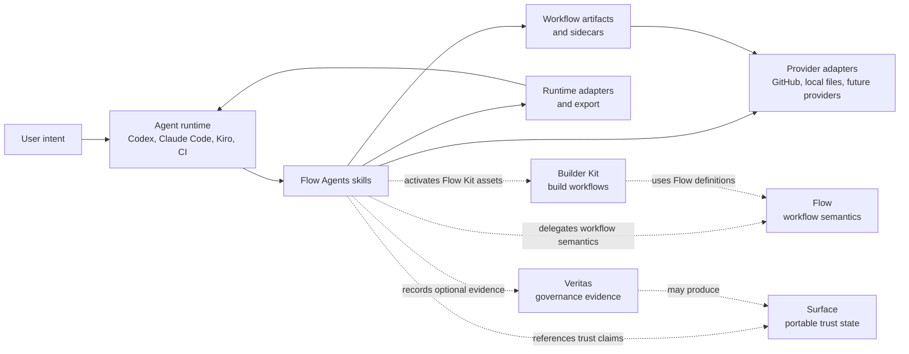
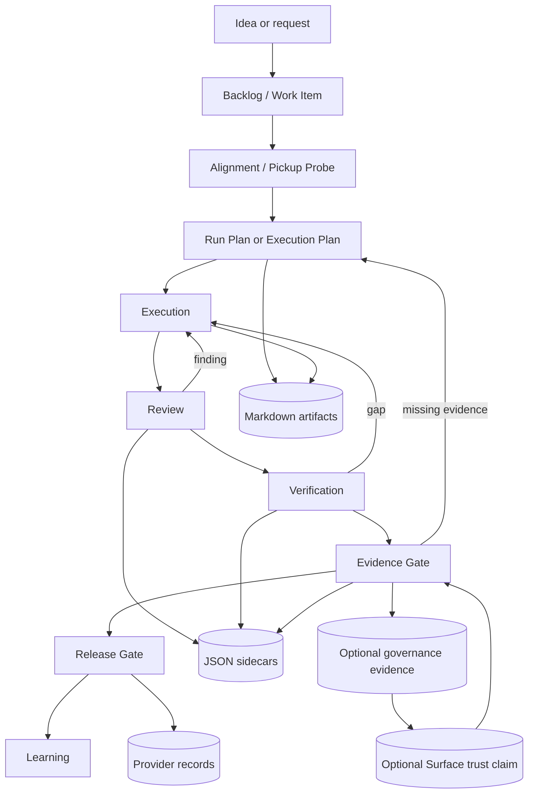

# Developer Architecture

This guide is the local starting point for Flow Agents maintainers who need to understand how this repository coordinates with Flow, Surface, Veritas, and Builder Kit. It describes the architecture from the Flow Agents side only; product-specific runtime details remain in their owning products.

**Package identity:** This source guide accompanies `@kontourai/flow-agents` version `10.0.0`, as declared in [`package.json`](../package.json). <!-- x-release-please-version -->

Release Please updates this binding alongside package metadata through the
`extra-files` entry in [`release-please-config.json`](../release-please-config.json).
It records the source package version, not publication or runtime qualification.
Changes to exports, dependencies, or build behavior still require review of the
corresponding architecture sections below.

Dependency identities and SDK compatibility come from `package.json` and the
resolved pnpm lockfile. The Knowledge Kit ships a self-contained YAML adapter
generated from the exact `yaml` development pin by `npm run knowledge:yaml:generate`;
the build checks that artifact before compiling. A YAML dependency update must
regenerate it alongside the lockfile. The optional Anthropic SDK remains behind
the optional-dependency boundary.

The Knowledge Kit also loads `neo4j-driver` 6.3 lazily as an optional dependency.
Its connection adapter uses the public `driver`, `auth.basic`, session and
connectivity APIs; selecting no graph or an unavailable graph retains the file
provider fallback. Provider unit and conformance tests use an injected driver.
They do not qualify a live Neo4j server or database migration.

The deterministic reviewed-grounding reference declares Forage as a development
dependency for its public snapshot store, reference builder and resolver. This
keeps acquisition persistence and exact replay with their owning package while
Lookout consumes the recorder's last handled snapshot reference.

The Knowledge Kit's dream run loads `@kontourai/traverse` lazily for schema-guided
extraction, so Traverse is an exact runtime dependency, not a development one.
`scripts/check-shipped-dependencies.mjs` (the `shipped-runtime-dependencies` CI
check) enforces that class: it lists the files `npm pack` would publish, parses
each shipped JavaScript or TypeScript source, and fails when a static import,
string-literal dynamic import or `require` names a package outside
`dependencies`, `peerDependencies` and `optionalDependencies`. A second pass
covers `require.resolve` and calls through a `createRequire` result, which esbuild
does not report. Exemptions carry a stated reason in the script. Non-literal
specifiers and Node code embedded in shell scripts are outside its view.

Test files (`*.test.js`, `*.test.mjs`, `*.test.cjs`) are excluded from the package
by `files` negations, except the kit evals a `kit.json` declares, which `files`
re-includes by path. The same check fails when a declared kit asset is missing
from the pack, so a new test-file eval needs its own `files` entry.

## Documentation tooling

`corpus.json` maps canonical guides to the source, schemas, integrations and hooks
they explain. Local `docs:check` and `docs:build` use the same reviewed Corpus
revision selected by the docs workflow. A source change
requires updated covering prose or a new complete local byte review explaining
why the existing claims remain accurate; the [review contract](https://github.com/kontourai/corpus/blob/b127e35a818b532369843731b3c64792baade83e/docs/related-content.md#review-an-unchanged-covering-document)
defines that alternative. Veritas governs evidence; Corpus checks the declared
relationships and reviewed bytes. Neither establishes live runtime or published
site correctness.

This guide is also the fallback review owner for `src/**`: changes to CLI
entrypoints, runtime modules and shared helpers require an architecture review
even when no narrower guide is mapped. Specific contract and integration guides
retain their own coverage. Narrative schemas belong to this source/schema
boundary; workspace-kit and retrospective schemas additionally select their
respective authoring and feedback guides. The engine-host integration reference
is reviewed here alongside its packaged runtime imports.

## Orientation

Flow Agents is the agent-facing operating layer. It turns a user's intent into workflow skills, local artifacts, sidecars, checks, and handoffs that a human or another agent can inspect later.

**Current state:** Flow Agents owns the portable agent bundle, skills, contracts, local workflow artifacts, runtime-specific exports, provider wiring, and validation scripts in this repository.

**Future direction:** Flow, Surface, Veritas, Builder Kit, and other Kontour products should continue converging on shared resource shapes and gate vocabulary without making this repository the owner of every product's runtime semantics.

Use these local references when you need more detail:

- [Context glossary](../CONTEXT.md) defines Flow Agents vocabulary.
- [Delegation groups](delegation-groups.md) defines the bounded contract/ledger package subpaths and required host capabilities; execution acceptance remains follow-up work.
- [Repository Structure](repository-structure.md) is the canonical map for source, generated output, runtime state, packaging, eval, and cleanup boundaries.
- [ADR 0003](adr/0003-flow-agents-coordinates-kits-and-adapters.md) records the kit and adapter boundary.
- [ADR 0005](adr/0005-kubernetes-inspired-resource-contracts.md) records the Kontour Resource Contract direction.
- [Kontour Resource Contract](kontour-resource-contract.md) documents the shared durable record shape.
- [Flow Kit Repository Contract](flow-kit-repository-contract.md) documents local kit validation and activation boundaries.
- [Veritas Integration Boundary](veritas-integration.md) records the early integration rationale; the shipped path is the external **Veritas Governance Kit** in [`kontourai/veritas`](https://github.com/kontourai/veritas), installed through the same Git repository contract as any other kit. See [Engine and kits](architecture-engine-and-kits.md).

## Coordination Map



**Current state:** Flow Agents coordinates local agent workflows with Markdown session artifacts, JSON sidecars, scripts, evals, and local docs. It validates Flow Kit repository shape and activates supported local Flow Definition assets for the implemented `codex-local` adapter.

**Future direction:** Flow should own authoritative workflow semantics, route decisions, gate enforcement, and Flow Definition validation. Flow Agents should stay the projection layer that makes those workflows usable inside agent runtimes and provider-backed workspaces.

## Ownership Boundaries

| Product | Owns | Flow Agents boundary |
| --- | --- | --- |
| Flow Agents | Agent-facing workflow bundles, skills, sidecars, artifact contracts, evals, runtime export, provider wiring, and local-first docs. | Does not become the core workflow engine for all Kontour products and should not copy product-native rule models into this repo. |
| Flow | Generic workflow semantics, Flow Definitions, gate transitions, attempts, route-back behavior, Flow Runs, and Flow Reports. | Flow Agents may consume or project Flow concepts, but Flow owns enforcement semantics once the Flow surface is available. |
| Builder Kit | The first Kontour-authored Flow Kit for build work: shaping, pickup probes, planning, execution, review, verification, publication, release readiness, and learning workflows. | Flow Agents validates, installs, activates, and routes Builder Kit assets; it does not make every Builder Kit specialization a core Flow Agents concept. |
| Veritas | The repo-local governance **evaluation engine** (`@kontourai/veritas`) and its external **Veritas Governance Kit**: repo standards, authority settings, policy/rule checks, setup guidance, and canonical readiness trust bundles. | Flow Agents installs the Veritas repository as a normal Git-backed Flow Kit, activates its supported assets, and hosts its generic gates. It neither bundles Veritas nor imports or reimplements its rules. |
| Surface | Portable trust state, claims, TrustReports, Trust Snapshots, and user-facing trust surfaces. | Flow Agents can reference Surface-shaped claims for gates, but Surface owns claim models and trust presentation. |

**Current state:** Builder Kit is the first proof point for extracting out-of-the-box behavior into normal Flow Kits. Veritas is consumed through the external **Veritas Governance Kit** at the root of the [`kontourai/veritas`](https://github.com/kontourai/veritas) repository. The kit wraps the standalone `veritas` CLI and gates its canonical trust bundle; Flow Agents remains the neutral kit host.

**Future direction:** Flow Agents should support more runtime adapters, provider adapters, and Flow Kits without forcing all users to install Builder Kit, Veritas, Surface, or a specific hosted provider.

## Artifact And Evidence Flow



**Current state:** The durable handoff surface is a pair of human-readable Markdown artifacts and machine-readable JSON sidecars under `.kontourai/flow-agents/<slug>/`. Verification, critique, release, and learning records are explicit artifacts rather than hidden chat memory.

**Programmatic API (for native hosts):** The canonical Builder runtime and sidecar writer/validator remain importable from the package root so a native host does not reimplement validated workflow mutation. Agent-facing Kit guidance uses the public `flow-agents workflow` command so gate ownership, assignment checks, command observation, and projection happen through one portable interface:

```js
import {
  validateTrustBundle,   // Hachure trust.bundle validation (the writer's validator)
  normalizeCheck,        // validate + normalize an evidence check (throws on invalid)
  normalizeLearning,     // validate + normalize a learning record
  validateEvidenceRef,   // validate a structured evidence reference
  readSidecar, writeSidecar, sidecarBase, writeState,
} from "@kontourai/flow-agents";
```

This is the same code the CLI runs; importing it does not execute the CLI. The sidecar JSON Schemas under `schemas/` remain the normative shape.

**Future direction:** Durable workflow state should converge toward Kontour Resource Contracts with versioned identity, desired state, observed status, and condition summaries. That convergence should preserve local files and provider-backed records as first-class surfaces.

## Knowledge learning lifecycle

Native hosts consume the versioned `knowledge-learning-contract`,
`knowledge-learning`, and `knowledge-learning-file` package subpaths. The
Knowledge kit declares the matching `learning-lifecycle` adapter. The owner
service retains proposals, evaluations, decisions, activation and effect
observations as revisioned receipts; `list(scope)` exposes the scoped review
queue without a consumer-maintained index. `active(scope)` exposes only guidance
whose retained evidence and lifecycle remain available.

The host supplies current authorization and exact evidence readers. The private
local-file adapter publishes receipts and materialized state atomically under
the existing subject lock, with a final authority fence. It refuses corrupt or
incomplete history rather than reconstructing active guidance from raw Knowledge
status. Activation registers guidance for context consumers; it does not install
a Skill or establish consumption, deployment or a successful effect. See the
[Knowledge lifecycle contract](../kits/knowledge/docs/learning-lifecycle.md) for
limits, capacity and operator recovery.

## Memory claims and routed review

Native hosts consume the `memory-claims`, `memory-routing` and `memory-routing-flow`
package subpaths; the Knowledge kit declares the matching `memory-claims` adapter.
The Kit owns the claim shape (a caller-owned schema it hands to Traverse, which stays
schema-neutral and proposals-only) and the routing policy. Survey owns verification
records, review items and reviewer decisions; Flow owns the evidence; Surface owns
which claims are current. A change no rule flags is recorded as `proposed`; a flagged
one also becomes a Survey review item. Each routing decision embeds the input and
policy it was computed from, so `recomputeMemoryRouting` can re-derive it, and is
recorded as custom-kind Flow evidence on a gate the host names. Flow 5.4 gates accept
only `trust.bundle` expectations, so that evidence is recomputable but not yet
required. The visibility order is Surface's (`meetVisibility`) and entity proposals are Survey's contract; both are consumed from the pinned releases (surface 6.3.0, survey 8.3.0), not restated. The host supplies the model call, the Survey verifier and the Flow run. See
the [memory claim contract](../kits/knowledge/docs/memory-claims.md) for the rules, the
evidence and the metrics.

## Runtime-session residue

The Knowledge kit's `runtime-session` residue source (#669) reads Claude Code and
Codex transcripts through the `@kontourai/ferry` importers into canonical
`@kontourai/thread` messages, which are the two runtime dependencies it adds. The
kit does not parse transcripts itself; the few facts Thread does not yet carry
are small shims that name their upstream issue. The host supplies the telemetry
file and the authorized transcript roots, ingest writes nothing, and it returns a
candidate cursor that the transaction owner commits only after its own work
succeeds. See the [Knowledge kit documentation](../kits/knowledge/docs/README.md#residue-sources-runtime-session-ingest)
for the cursor rule, drift handling and scrub guarantees.

## Memory-root proposals

The Knowledge kit can stage distilled session candidates through a host-supplied
Corpus store adapter for an authorized memory root. The proposal includes session,
transcript and sitting provenance; Corpus owns the pending proposal and its review
transaction. Staging does not apply a record or establish its review state. The
repository pins `@kontourai/corpus-store` as a development dependency to exercise
the integration; the host supplies the adapter at runtime. See the
[proposal target documentation](../kits/knowledge/docs/README.md) for registration,
retry and recovery boundaries.

## Memory claims and routed review

Native hosts consume the `memory-claims`, `memory-routing` and `memory-routing-flow`
package subpaths; the Knowledge kit declares the matching `memory-claims` adapter.
The Kit owns the claim shape (a caller-owned schema it hands to Traverse, which stays
schema-neutral and proposals-only) and the routing policy. Survey owns verification
records, review items and reviewer decisions; Flow owns the evidence; Surface owns
which claims are current. A change no rule flags is recorded as `proposed`; a flagged
one also becomes a Survey review item. Each routing decision embeds the input and
policy it was computed from, so `recomputeMemoryRouting` can re-derive it, and is
recorded as custom-kind Flow evidence on a gate the host names. Flow 5.4 gates accept
only `trust.bundle` expectations, so that evidence is recomputable but not yet
required. The visibility order is Surface's (`meetVisibility`) and entity proposals are Survey's contract; both are consumed from the pinned releases (surface 6.3.0, survey 9.0.0), not restated. The host supplies the model call, the Survey verifier and the Flow run. See
the [memory claim contract](../kits/knowledge/docs/memory-claims.md) for the rules, the
evidence and the metrics.

### Host entries for memory the host keeps

A host that keeps its own memory and briefs from it imports five more subpaths. Each points at the
Knowledge kit's own module, so there is one implementation of each; the `.d.ts` files beside them
are checked against the runtime exports by `src/cli/memory-host-subpaths.test.mjs`.

| Subpath | Exports | Use |
| --- | --- | --- |
| `@kontourai/flow-agents/memory-envelope` | `encodeEnvelope`, `decodeEnvelope`, `indexProposals` and the envelope limits | Read and write the dream run's published envelope; a malformed or unknown-version envelope is refused, not repaired. |
| `@kontourai/flow-agents/memory-entity-envelope` | `encodeEntityEnvelope`, `decodeEntityEnvelope`, `indexEntityProposals`, `entityProposalKey`, `entityProposalTitle`, the category `memory.entity-proposal` and its bounds | Carry a merge, split or alias proposal in a memory root beside the claims. The body is `{ version, proposal }` with Survey's `EntityProposal`, accepted only when Survey rebuilds it from its `spec` to the same canonical JSON. It detects and applies nothing, and every bound refuses at max + 1. |
| `@kontourai/flow-agents/memory-marker` | `INJECTED_MEMORY_OPEN`, `INJECTED_MEMORY_CLOSE` | The markers that wrap injected memory, so a transcript reader can skip it instead of ingesting it as new memory. |
| `@kontourai/flow-agents/memory-brief` | `compileBrief`, `rankItems`, `classifyCurrent`, `effectiveItems`, `isSealed`, `writeBriefs` and the budget defaults | Rank eligible claims with `rankItems`, then pass them to `compileBrief`; its byte budget covers joined display entries, not the serialized JSON. `writeBriefs` combines these steps. |
| `@kontourai/flow-agents/memory-recall` | `recallMemoryClaims` | Select lexical matches and passages from claim excerpts, with labels, missing terms and abstention reasons. An `answered` result does not establish semantic answer correctness. |

The host must pass only claims the reader is authorized to see and supply trusted review and routing records. These helpers do not authenticate callers or enforce restricted-audience membership. Ranking and recall exclude sealed claims; `compileBrief` expects already-ranked inputs. `rankItems` uses `now` for ranking, while `classifyCurrent` has no as-of input.
Recall's current, contested and superseded labels use the brief's local rules. They are not Surface's protected accumulation projection; the authority input needed for that projection is tracked in flow-agents#1586.

A host that runs the dream as a command instead of calling `runDream` uses `flow-agents dream run --config <abs>`.
`src/cli/dream.ts` forwards that command to `kits/knowledge/dream/cli.js`, so the arguments, report and exit codes stay
in the kit. [Dream run model setup](../kits/knowledge/docs/README.md#dream-run-model-setup) lists the model runtimes
the command accepts. `src/cli/dream-adoption.test.mjs` drives that command against fake `claude` executables and polls
their JSON-lines logs while they are still appending, so it reads only lines already ended by a newline.

`flow-agents learn` forwards the same way, from `src/cli/learn.ts` to `kits/knowledge/learn/cli.js`; see
[the learn loop](../kits/knowledge/docs/learn.md).

## Delegation authority and bounded rounds

The package exports separate `delegation-group-rounds` and
`delegation-group-rounds-local-file` subpaths for checkpoint-authorized rounds
and their durable local store. `delegation-authority-service-v3` and
`delegation-authority-local-file-v3` add explicit authority renewal; the rounds
controller explicitly adopts renewed authority. These additive modules preserve
existing v2 entrypoints. The rounds controller composes
Flow-owned scheduling rather than maintaining another ready-frontier model.

The package and privileged lifecycle coordinator both pin Flow 5.4.0. The
coordinator's separate staged closure retains its complete npm lockfile and
whole-closure digest; changing the package dependency alone cannot authorize a
new reducer. A pin migration verifies the published release commit and reducer
identity, updates the staged closure and exact admission check together, and
retains refusal of stale pins and mismatched installed package versions. The
5.4.0 migration preserves the reducer's 1.3.8 identity and existing dependency
integrities. This package alignment does not establish that a consumer loads
one shared Flow module instance.

Hosts that also call Flow import `assertDelegationFlowRuntime` from
`@kontourai/flow-agents/delegation-flow-runtime` (also exported at the package
root). Before retaining or issuing authority, claiming work or launching effects,
they pass their actual `loadRun` and `withRunMutationLock` imports to the
assertion. It compares both function references with the bindings used by Flow
Agents in the same JavaScript realm and refuses a mismatch with
`delegation_flow_runtime_mismatch`, without calling either supplied function.
Separate module copies can have separate mutation-lock token registries even
when their version strings match. Passing this check grants no execution
authority; dependency alignment, publication and the consuming host's installed
module composition still require their own verification.

Retained-tariff accounting is opt-in through the AccountingV1 entrypoints and
`accountingProtocol: "retained-tariff-v1"` on rounds hosts. It preserves integer
micros and their tariff basis; default entrypoints retain their existing
provider-reported Relay-dollar behavior. Unknown usage retains its allocation.
These contracts do not authenticate a consumer's runtime, source, credential,
recipient session or custody-transfer receipt. Those facts and the physical
launch fences remain the consuming host's responsibility. The
[delegation guide](delegation-groups.md) specifies these boundaries, including
storage-only synchronization finalization and fresh session-bound ACKs after
renewal. Source exports and packed-package checks do not establish publication
or a serving consumer.

## Local Workflow Roles

Flow Agents workflows separate selection, planning, execution, critique, verification, evidence, release, and learning so each stage leaves inspectable state.

**Current state:**

- `pull-work` selects work, checks WIP and dependency context, and records the pickup decision.
- `plan-work` produces an execution plan with acceptance criteria, scope, risks, and verification expectations.
- `execute-plan` implements the approved plan and records modified files.
- `review-work` and `verify-work` produce report-only critique and evidence.
- `evidence-gate`, `release-readiness`, and `learning-review` decide whether the work is trustworthy, acceptable, and worth feeding back into the system.

**Future direction:** Flow-owned runs and gates should be able to supply the same structure to local agents, CI agents, and hosted control planes without depending on a particular chat runtime.

## Resource Contract Alignment

Kontour Resource Contracts provide the shared shape for durable records that cross product or adapter boundaries.

**Current state:** Flow Agents already uses local workflow artifacts and sidecars as the operational handoff surface. New shared contracts should prefer the Kontour Resource Contract shape unless a product records a specific exception.

**Future direction:** Active Workflow Runs, Selected Scope, Gate status, provider evidence, Surface claims, and Veritas report pointers should become easier to compare because they use compatible identity, metadata, desired intent, observed status, and condition-style summaries.

## Reading Order For Contributors

Start here, then follow the local docs in this order:

1. [Workflow Usage Guide](workflow-usage-guide.md) for the user-facing delivery path.
2. [Repository Structure](repository-structure.md) for where changes belong and what is generated or runtime-only.
3. [Skills Map](skills-map.md) for workflow phase composition.
4. [Workflow Artifact Lifecycle](workflow-artifact-lifecycle.md) for what stays local, what gets promoted, and what must not be merged.
5. [Flow Kit Repository Contract](flow-kit-repository-contract.md) for kit repository validation and activation behavior.
6. [Veritas Integration Boundary](veritas-integration.md) for optional governance evidence.
7. [Developer Reference](context-map.md) for generated repository structure, commands, agents, skills, scripts, and contracts.

## Standalone Codex runtime distribution

Codex home installs carry executable public runtime imports under
`build/src/vendor/`, generated by `npm run build:bundles`. Existing Conduit,
Datum, Survey browser assets, and Flow validator bundles remain in place. The
Codex build also resolves remaining literal public package imports from the
current dependency graph and bundles their code, original license notices (or
published SPDX metadata when a package ships no notice file), and version/digest
provenance. This does not copy a flat npm dependency tree or change Flow-owned
process semantics. For npm aliases the builder validates the exact published
target name and version and records both that identity and the local specifier.
Surface's original trust-panel element and exact package
metadata also ship with its entry; synchronous narrative reads and panel rendering
use those owned files. Survey retains the version metadata of its own resolved
Surface dependency, including when that differs from Flow Agents' direct pin.
The shared workflow trust gates retain Surface 5 and its status-function behavior.
Knowledge projection, Living Context recall, and memory routing use Surface 6.3.0
through the `@kontourai/surface-knowledge` alias for erasure, derived visibility,
and accumulation. Standalone Knowledge projection can use an erasure-capable
Surface under its ordinary name; recall requires Surface 6.3.0 or later with derived
visibility. Packaged memory modules include their alias through Flow Agents. Survey
is pinned to 8.4.0.
Relay's optional SDK import and the engine-host's own integration imports are
bound to packaged code instead of an ambient npm installation.
Flow's original schemas remain local to its vendor entry;
packaging exposes its literal CommonJS imports to esbuild without changing the
validators. A packaging-owned asset relocator reads the upstream validator's
entry-relative package lookup and resolves only a dependency declared by that
validator's owning package. Flow therefore retains its own resolved Hachure
schemas, version metadata, and licenses, even when Surface resolves another
version. The relocator records owner/version and asset digests; it adds no direct
product-format dependency. Dependency upgrades that change these packaging seams
fail the build.

The shared kit-root resolver recognizes that same owned runtime metadata and marker,
so installed kit declarations and canonical run binding find the same tree.
Gate-action envelopes select that owned metadata through the same accessor while
retaining their bounded, stable regular-file reader. Narrative CLI version
provenance also uses this owned metadata.
Installed package metadata comes from the owned `build/package.json`, so commands
do not need a user project's `package.json`. Build tools load esbuild only when
building; installed command execution needs no compiler, npm install, or cache.
The production dependency pins esbuild to `0.28.2`, with the same exact version
authorized in `pnpm-workspace.yaml`. Bundler updates must regenerate and check
Knowledge YAML and runtime bundles, retaining their licenses and provenance;
the generated runtime target remains Node 22.
Generated runtime bundles add an ES module package boundary around the Knowledge
kit so the shared injected-memory marker loads on early Node 22. The source kit
does not carry that boundary: it would shadow the package self-references used
by its adapters. Direct imports of generated bundle adapters from a checkout or
linked install remain a known limitation ([#1594](https://github.com/kontourai/flow-agents/issues/1594));
the packed-install layout resolves those imports.
`build/runtime-imports.json` inventories the compiled runtime, vendor files and
canonical config seed (`.codex/hooks.json` or `.claude/settings.json`). Codex
retains that seed separately from the flattened, merged user `hooks.json`; the
existing ownership manifest records it like other installed files. Standalone
uninstall reads the seed through the shared inventory verifier, without compiling
or installing dependencies after package/cache eviction. Missing, changed or
symlinked seeds and missing/corrupt inventory refuse before removal. Current user
hooks never become the canonical managed seed. Recorded installed values, config
lineage and hash-based file ownership retain their existing removal rules.
The Codex installer verifies that exact inventory before writing, then the
existing install manifest owns those files and their SHA-256 digests. Kit selection
continues to come from explicit installation flags and kit declarations.
Telemetry configuration is applied to the staging overlay before ownership
preflight, so the manifest records the final local-only pin or Console settings.
Repeated installs recognize those installer-written bytes; operator edits still
fail ownership preflight before destination writes.

`bash evals/integration/test_published_codex_install.sh` packs and installs an npm
consumer, rejects corrupt bundles, removes that consumer and its cache, and runs
CLI help, workflow start/status, and external kit validate/install/list/run from an
empty project. This is local packed-artifact evidence; registry release, live
model providers, native harness operation, and publication remain separate
qualification steps.


## Eval tooling and dependency security

Promptfoo is development evaluation tooling, separate from the packaged runtime
contracts. Its dependency updates can also refresh transitive packages shared with
the runtime, so review the complete frozen lockfile and both full and
production-only audit results. A clean production audit does not clear remaining
development or optional-provider findings; denied build scripts do not prove that
prebuilt native packages are unreachable.

The [eval guide](../evals/README.md) records the supported tooling, offline
compatibility checks and remaining dependency findings. Offline CLI and loopback
metadata fixtures establish local compatibility, not cloud-provider, native
inference or registry-release qualification. These updates retain the published
runtime's direct dependency pins, explicit native-script policy and release-age
rules.

## Durable Claude Code global runtime

`init --runtime claude-code --global` installs the built Claude bundle runtime
under `<dest>/.flow-agents/runtime/`. npm and the invoking consumer directory are
delivery sources; managed hook argv and the shell statusline refer only to this
owned runtime. Hooks retain literal argv paths; only the statusline's double-quoted
shell path is escaped, including dollar signs, backticks, quotes and backslashes.
Apostrophes remain literal in both forms.

The Claude bundle uses the same standalone dependency bundling, public package
contracts, license/provenance records and `build/runtime-imports.json` as Codex.
Both installers verify that inventory before destination writes. No destination
build or npm install occurs. Kits retain their declarations and selection rules;
this distribution repair does not move methodology or policy into the adapter.

Kit discovery and canonical run binding share `canonicalKitsRoot`. Runtime artifact
storage remains excluded, with one installation-specific exception: the exact
physical `kits/` directory beside the executing package, compared by real path.
The identity is derived from the loaded module, never project metadata, cwd or an
environment override. A sibling kit directory under `.flow-agents/` and a symlink
into such a sibling remain refused; a symlink to the executing package's exact
kit bytes is only an alias. Redirecting the package's own `kits/` symlink outside
its physical root grants no exception. Replacing the executing installation's
code or bytes is still same-uid code tampering, outside this local protection's
external CI/owner-review trust boundary.

This also applies to OpenCode global and Kiro's default `~/.flow-agents` install.
Those bundles now receive the same standalone public dependency closure and
`build/runtime-imports.json` marker; without them the CLI could fail module loading
before discovery and the loaded resolver could not identify its kit tree.
The Stop hook loads the installed resolver for Builder gate expectations; before
this exception, artifact-root refusal could make its lookup return null and use
the generic `workflow.*` fallback. Unknown-flow admission diagnostics now name
skipped sources and their refusal reasons. The `delivery` rule remains unchanged:
non-git cwd roots also declare `delivery/` as artifact storage, so narrowing only
kit discovery would disagree with artifact protection.

`node --test src/cli/vendored-runtime-kits.test.mjs` performs global installs in
scratch HOMEs, checks workflow admission and the installed hook's Builder gate
lookup, and refuses copied package metadata in agent artifact storage. This
establishes local lookup behavior, not live harness or provider qualification.

The existing ownership plan and `.flow-agents/owned-files.json` cover runtime,
skills and agents together. The runtime retains the canonical `.claude/settings.json`
seed so its own uninstall command needs no source package or build. Runtime collisions refuse installation even with
`--force`; user skills/agents retain their existing preserve/force behavior.
Invalid settings JSON refuses before any destination writes. Dry-run includes
runtime copies and changes no destination files. Upgrades replace hash-matching
owned runtime files; uninstall removes unchanged owned files and preserves edits
and unrelated user settings. Stale runtime files remain subject to the existing
additive global-install policy rather than gaining new deletion authority.

`node evals/integration/test_global_install_npx_durability.mjs` exercises packed
artifact source eviction, all managed argv hooks and the shell statusline,
standalone CLI loading, hostile/apostrophe paths, corruption/collision refusal,
invalid settings, dry-run, repeat installation and uninstall. Run after
`npm run build:bundles`, with actual Node and Python binaries on PATH before HOME
is isolated. Set `FLOW_AGENTS_PACK_EVIDENCE_DIR` to retain the tested tarball and
SHA256SUMS. The test writes the bundle pack first (as `prepack` does), checks
that the tarball holds no `dist/`, `src/` or `evals/`, installs from the pack alone,
and expands a bundle next to the package only for the steps that edit one.
This simulates npm source eviction; real Claude sessions, registry
publication and provider execution require separate qualification.

### How the published package carries the install bundles

`npm run build:bundles` writes one full tree per harness under `dist/`. Those trees
share most of their bytes and a host that only imports the package never reads them,
so the published package does not ship `dist/`. `prepack` runs
`node build/src/tools/bundle-pack-cli.js pack`, which writes every distinct file once
into `bundles/flow-agents-bundles.pack`: a header listing each path, mode and SHA-256,
then one Brotli stream. The package also leaves out `src/` and `evals/`.

`init`, `kit`, `workflow doctor` and `uninstall` ask
`src/lib/bundle-store.ts` for a harness. The Codex installer expands the same pack directly. The resolver returns the package's own `dist/<harness>`
when one is built (a checkout), and otherwise expands that harness from the pack into
a private temporary directory that is removed when the command ends. Every blob is
checked against its SHA-256 before the first file is written, so a damaged pack is
refused whichever harness was asked for and writes nothing. Nothing is compiled or
downloaded, and the installed package directory is never written to. The decision to
pack rather than to generate the bundles at install time is in
`docs/decisions/` (consumers must not compile; the builder is not hoist-aware).
`node build/src/tools/bundle-pack-cli.js info` prints what a pack holds, and
`extract <dir> [harness...]` expands it for inspection.
