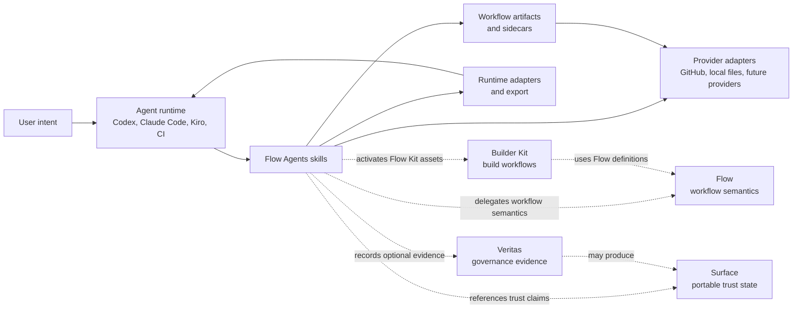
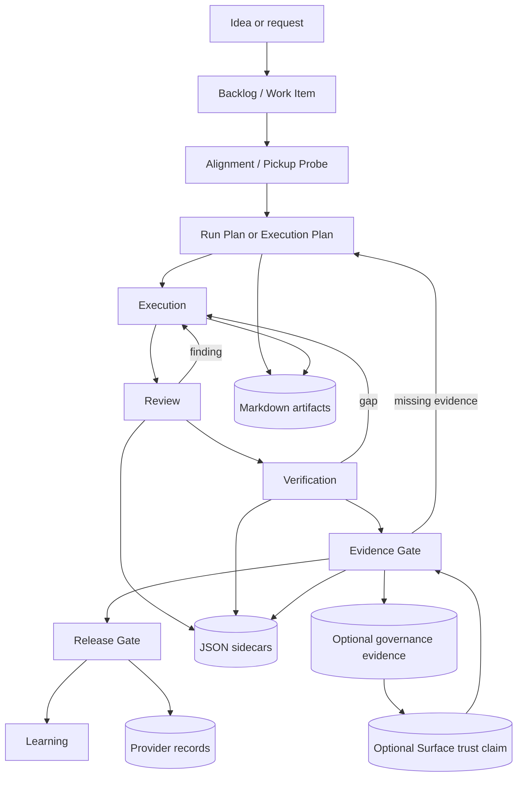

# Developer Architecture

This guide is the local starting point for Flow Agents maintainers who need to understand how this repository coordinates with Flow, Surface, Veritas, and Builder Kit. It describes the architecture from the Flow Agents side only; product-specific runtime details remain in their owning products.

## Orientation

Flow Agents is the agent-facing operating layer. It turns a user's intent into workflow skills, local artifacts, sidecars, checks, and handoffs that a human or another agent can inspect later.

**Current state:** Flow Agents owns the portable agent bundle, skills, contracts, local workflow artifacts, runtime-specific exports, provider wiring, and validation scripts in this repository.

**Future direction:** Flow, Surface, Veritas, Builder Kit, and other Kontour products should continue converging on shared resource shapes and gate vocabulary without making this repository the owner of every product's runtime semantics.

Use these local references when you need more detail:

- [Context glossary](../CONTEXT.md) defines Flow Agents vocabulary.
- [Repository Structure](repository-structure.md) is the canonical map for source, generated output, runtime state, packaging, eval, and cleanup boundaries.
- [ADR 0003](adr/0003-flow-agents-coordinates-kits-and-adapters.md) records the kit and adapter boundary.
- [ADR 0005](adr/0005-kubernetes-inspired-resource-contracts.md) records the Kontour Resource Contract direction.
- [Kontour Resource Contract](kontour-resource-contract.md) documents the shared durable record shape.
- [Flow Kit Repository Contract](flow-kit-repository-contract.md) documents local kit validation and activation boundaries.
- [Veritas Integration Boundary](veritas-integration.md) records the early integration rationale; the shipped path is the external **Veritas Governance Kit** in [`kontourai/veritas`](https://github.com/kontourai/veritas), installed through the same Git repository contract as any other kit. See [Engine and kits](architecture-engine-and-kits.md).

## Coordination Map



**Current state:** Flow Agents coordinates local agent workflows with Markdown session artifacts, JSON sidecars, scripts, evals, and local docs. It validates Flow Kit repository shape and activates supported local Flow Definition assets for the implemented `codex-local` adapter.

**Future direction:** Flow should own authoritative workflow semantics, route decisions, gate enforcement, and Flow Definition validation. Flow Agents should stay the projection layer that makes those workflows usable inside agent runtimes and provider-backed workspaces.

## Ownership Boundaries

| Product | Owns | Flow Agents boundary |
| --- | --- | --- |
| Flow Agents | Agent-facing workflow bundles, skills, sidecars, artifact contracts, evals, runtime export, provider wiring, and local-first docs. | Does not become the core workflow engine for all Kontour products and should not copy product-native rule models into this repo. |
| Flow | Generic workflow semantics, Flow Definitions, gate transitions, attempts, route-back behavior, Flow Runs, and Flow Reports. | Flow Agents may consume or project Flow concepts, but Flow owns enforcement semantics once the Flow surface is available. |
| Builder Kit | The first Kontour-authored Flow Kit for build work: shaping, pickup probes, planning, execution, review, verification, publication, release readiness, and learning workflows. | Flow Agents validates, installs, activates, and routes Builder Kit assets; it does not make every Builder Kit specialization a core Flow Agents concept. |
| Veritas | The repo-local governance **evaluation engine** (`@kontourai/veritas`) and its external **Veritas Governance Kit**: repo standards, authority settings, policy/rule checks, setup guidance, and canonical readiness trust bundles. | Flow Agents installs the Veritas repository as a normal Git-backed Flow Kit, activates its supported assets, and hosts its generic gates. It neither bundles Veritas nor imports or reimplements its rules. |
| Surface | Portable trust state, claims, TrustReports, Trust Snapshots, and user-facing trust surfaces. | Flow Agents can reference Surface-shaped claims for gates, but Surface owns claim models and trust presentation. |

**Current state:** Builder Kit is the first proof point for extracting out-of-the-box behavior into normal Flow Kits. Veritas is consumed through the external **Veritas Governance Kit** at the root of the [`kontourai/veritas`](https://github.com/kontourai/veritas) repository. The kit wraps the standalone `veritas` CLI and gates its canonical trust bundle; Flow Agents remains the neutral kit host.

**Future direction:** Flow Agents should support more runtime adapters, provider adapters, and Flow Kits without forcing all users to install Builder Kit, Veritas, Surface, or a specific hosted provider.

## Artifact And Evidence Flow



**Current state:** The durable handoff surface is a pair of human-readable Markdown artifacts and machine-readable JSON sidecars under `.kontourai/flow-agents/<slug>/`. Verification, critique, release, and learning records are explicit artifacts rather than hidden chat memory.

**Programmatic API (for native hosts):** The canonical Builder runtime and sidecar writer/validator remain importable from the package root so a native host does not reimplement validated workflow mutation. Agent-facing Kit guidance uses the public `flow-agents workflow` command so gate ownership, assignment checks, command observation, and projection happen through one portable interface:

```js
import {
  validateTrustBundle,   // Hachure trust.bundle validation (the writer's validator)
  normalizeCheck,        // validate + normalize an evidence check (throws on invalid)
  normalizeLearning,     // validate + normalize a learning record
  validateEvidenceRef,   // validate a structured evidence reference
  readSidecar, writeSidecar, sidecarBase, writeState,
} from "@kontourai/flow-agents";
```

This is the same code the CLI runs; importing it does not execute the CLI. The sidecar JSON Schemas under `schemas/` remain the normative shape.

**Future direction:** Durable workflow state should converge toward Kontour Resource Contracts with versioned identity, desired state, observed status, and condition summaries. That convergence should preserve local files and provider-backed records as first-class surfaces.

## Local Workflow Roles

Flow Agents workflows separate selection, planning, execution, critique, verification, evidence, release, and learning so each stage leaves inspectable state.

**Current state:**

- `pull-work` selects work, checks WIP and dependency context, and records the pickup decision.
- `plan-work` produces an execution plan with acceptance criteria, scope, risks, and verification expectations.
- `execute-plan` implements the approved plan and records modified files.
- `review-work` and `verify-work` produce report-only critique and evidence.
- `evidence-gate`, `release-readiness`, and `learning-review` decide whether the work is trustworthy, acceptable, and worth feeding back into the system.

**Future direction:** Flow-owned runs and gates should be able to supply the same structure to local agents, CI agents, and hosted control planes without depending on a particular chat runtime.

## Resource Contract Alignment

Kontour Resource Contracts provide the shared shape for durable records that cross product or adapter boundaries.

**Current state:** Flow Agents already uses local workflow artifacts and sidecars as the operational handoff surface. New shared contracts should prefer the Kontour Resource Contract shape unless a product records a specific exception.

**Future direction:** Active Workflow Runs, Selected Scope, Gate status, provider evidence, Surface claims, and Veritas report pointers should become easier to compare because they use compatible identity, metadata, desired intent, observed status, and condition-style summaries.

## Reading Order For Contributors

Start here, then follow the local docs in this order:

1. [Workflow Usage Guide](workflow-usage-guide.md) for the user-facing delivery path.
2. [Repository Structure](repository-structure.md) for where changes belong and what is generated or runtime-only.
3. [Skills Map](skills-map.md) for workflow phase composition.
4. [Workflow Artifact Lifecycle](workflow-artifact-lifecycle.md) for what stays local, what gets promoted, and what must not be merged.
5. [Flow Kit Repository Contract](flow-kit-repository-contract.md) for kit repository validation and activation behavior.
6. [Veritas Integration Boundary](veritas-integration.md) for optional governance evidence.
7. [Developer Reference](context-map.md) for generated repository structure, commands, agents, skills, scripts, and contracts.

## Standalone Codex runtime distribution

Codex home installs carry executable public runtime imports under
`build/src/vendor/`, generated by `npm run build:bundles`. Existing Conduit,
Datum, Survey browser assets, and Flow validator bundles remain in place. The
Codex build also resolves remaining literal public package imports from the
current dependency graph and bundles their code, original license notices (or
published SPDX metadata when a package ships no notice file), and version/digest
provenance. This does not copy a flat npm dependency tree or change Flow-owned
process semantics. Surface's original trust-panel element and exact package
metadata also ship with its entry; synchronous narrative reads and panel rendering
use those owned files. Survey retains the version metadata of its own resolved
Surface dependency, including when that differs from Flow Agents' direct pin.
Relay's optional SDK import and the engine-host's own integration imports are
bound to packaged code instead of an ambient npm installation.
Flow's original schemas remain local to its vendor entry;
packaging exposes its literal CommonJS imports to esbuild without changing the
validators. A packaging-owned asset relocator reads the upstream validator's
entry-relative package lookup and resolves only a dependency declared by that
validator's owning package. Flow therefore retains its own resolved Hachure
schemas, version metadata, and licenses, even when Surface resolves another
version. The relocator records owner/version and asset digests; it adds no direct
product-format dependency. Dependency upgrades that change these packaging seams
fail the build.

The shared kit-root resolver recognizes that same owned runtime metadata and marker,
so installed kit declarations and canonical run binding find the same tree.
Gate-action envelopes select that owned metadata through the same accessor while
retaining their bounded, stable regular-file reader. Narrative CLI version
provenance also uses this owned metadata.
Installed package metadata comes from the owned `build/package.json`, so commands
do not need a user project's `package.json`. Build tools load esbuild only when
building; installed command execution needs no compiler, npm install, or cache.
The production dependency pins esbuild to `0.28.2`, with the same exact version
authorized in `pnpm-workspace.yaml`. Bundler updates must regenerate and check
Knowledge YAML and runtime bundles, retaining their licenses and provenance;
the generated runtime target remains Node 22.
`build/runtime-imports.json` inventories the compiled runtime, vendor files and
canonical config seed (`.codex/hooks.json` or `.claude/settings.json`). Codex
retains that seed separately from the flattened, merged user `hooks.json`; the
existing ownership manifest records it like other installed files. Standalone
uninstall reads the seed through the shared inventory verifier, without compiling
or installing dependencies after package/cache eviction. Missing, changed or
symlinked seeds and missing/corrupt inventory refuse before removal. Current user
hooks never become the canonical managed seed. Recorded installed values, config
lineage and hash-based file ownership retain their existing removal rules.
The Codex installer verifies that exact inventory before writing, then the
existing install manifest owns those files and their SHA-256 digests. Kit selection
continues to come from explicit installation flags and kit declarations.
Telemetry configuration is applied to the staging overlay before ownership
preflight, so the manifest records the final local-only pin or Console settings.
Repeated installs recognize those installer-written bytes; operator edits still
fail ownership preflight before destination writes.

`bash evals/integration/test_published_codex_install.sh` packs and installs an npm
consumer, rejects corrupt bundles, removes that consumer and its cache, and runs
CLI help, workflow start/status, and external kit validate/install/list/run from an
empty project. This is local packed-artifact evidence; registry release, live
model providers, native harness operation, and publication remain separate
qualification steps.


## Eval tooling and dependency security

Promptfoo is development evaluation tooling, separate from the packaged runtime
contracts. Its dependency updates can also refresh transitive packages shared with
the runtime, so review the complete frozen lockfile and both full and
production-only audit results. A clean production audit does not clear remaining
development or optional-provider findings; denied build scripts do not prove that
prebuilt native packages are unreachable.

The [eval guide](../evals/README.md) records the supported tooling, offline
compatibility checks and remaining dependency findings. Offline CLI and loopback
metadata fixtures establish local compatibility, not cloud-provider, native
inference or registry-release qualification. These updates retain the published
runtime's direct dependency pins, explicit native-script policy and release-age
rules.

## Durable Claude Code global runtime

`init --runtime claude-code --global` installs the built Claude bundle runtime
under `<dest>/.flow-agents/runtime/`. npm and the invoking consumer directory are
delivery sources; managed hook argv and the shell statusline refer only to this
owned runtime. Hooks retain literal argv paths; only the statusline's double-quoted
shell path is escaped, including dollar signs, backticks, quotes and backslashes.
Apostrophes remain literal in both forms.

The Claude bundle uses the same standalone dependency bundling, public package
contracts, license/provenance records and `build/runtime-imports.json` as Codex.
Both installers verify that inventory before destination writes. No destination
build or npm install occurs. Kits retain their declarations and selection rules;
this distribution repair does not move methodology or policy into the adapter.

The existing ownership plan and `.flow-agents/owned-files.json` cover runtime,
skills and agents together. The runtime retains the canonical `.claude/settings.json`
seed so its own uninstall command needs no source package or build. Runtime collisions refuse installation even with
`--force`; user skills/agents retain their existing preserve/force behavior.
Invalid settings JSON refuses before any destination writes. Dry-run includes
runtime copies and changes no destination files. Upgrades replace hash-matching
owned runtime files; uninstall removes unchanged owned files and preserves edits
and unrelated user settings. Stale runtime files remain subject to the existing
additive global-install policy rather than gaining new deletion authority.

`node evals/integration/test_global_install_npx_durability.mjs` exercises packed
artifact source eviction, all managed argv hooks and the shell statusline,
standalone CLI loading, hostile/apostrophe paths, corruption/collision refusal,
invalid settings, dry-run, repeat installation and uninstall. Run after
`npm run build:bundles`, with actual Node and Python binaries on PATH before HOME
is isolated. Set `FLOW_AGENTS_PACK_EVIDENCE_DIR` to retain the tested tarball and
SHA256SUMS. npm packaging excludes the transient `dist/.build-lock/` directory.
This simulates npm source eviction; real Claude sessions, registry
publication and provider execution require separate qualification.
