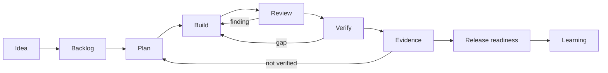

# Flow Agents

A portable process-discipline layer for agentic work: a kit-neutral engine for FlowDefinition interpretation, gates, runtime adapters, evidence, trust, and kit validation — plus opt-in kits such as Builder, Knowledge, Release Evidence, and Veritas Governance. Flow Agents keeps work inspectable so you ask for outcomes and the selected kit supplies the path, the state, the checks, and the proof.

- **Kit-neutral engine.** FlowDefinition interpretation, gates, runtime and harness adapters, SDK/evidence/trust primitives, and kit validation. The engine is not Builder Kit; Builder is one kit on top.
- **Survive context loss.** Durable sidecar state under `.kontourai/flow-agents/` records acceptance criteria, evidence, critique, and handoff, so any session resumes from recorded state instead of chat memory.
- **Tamper-evident trust.** Local capture is advisory and best-effort; the controlled CI re-run reconciles manifest commands and git diff as the authoritative anchor before evidence is treated as CI-verified.
- **Flow Kits — workflow + output shape.** A kit bundles flows and optional skills, docs, adapters, evals, and assets as a validated, installable unit. The catalog lists Builder, Knowledge, Release Evidence, and Veritas Governance; [bring your own kit](kit-authoring-guide.md) through the same manifest path.

## How it works



Flow Agents adds the operating layer around the model: the engine preserves state, evaluates evidence, activates selected kits, renders structured kit triggers, and compiles canonical policies to host hooks. The gate semantics underneath — definitions, runs, evidence, route-back — belong to <a href="https://kontourai.github.io/flow/">Kontour Flow</a>.

Kits supply the workflow. Builder and Knowledge are examples on the engine, not the engine itself. The built-in catalog also includes Release Evidence and Veritas Governance, both useful proof points that a kit can be agentless and still run through the same manifest and gate model.

## Process-discipline layer

The four canonical policy classes are defined in the <a href="spec/runtime-hook-surface.md">Runtime Hook Surface spec</a> using a runtime-neutral vocabulary. Adapters translate them to the host's native hook format at three conformance levels: <strong>L0</strong> (telemetry only), <strong>L1</strong> (steering + stop-goal-fit warning), and <strong>L2</strong> (all four policies with blocking capability).

### Runtime and support matrix

| Tier | Runtime | Ships | Conformance |
| --- | --- | --- | --- |
| Core harness | Claude Code | install + hooks + bundle | L2 — reference implementation |
| Core harness | Codex | install + hooks + bundle | L2 — reference implementation |
| Core harness | Kiro | install + hooks + bundle | L2 |
| Core harness | opencode | agents, skills, plugin, opencode.json | L1 — no prompt-submit hook |
| Core harness | pi | extension, skills, AGENTS.md | L1 — no stop hook |
| Official framework adapter | AWS Strands (Python) | `integrations/strands/` spike/preview | L0 + config protection via cancellation |
| Official framework adapter | AWS Strands (TypeScript) | `integrations/strands-ts/` native-import preview | shipped telemetry + native config protection; L2-targeted policies run through the conformance shim |
| Conformance-certified | Community / third-party | Self-certify | Conformance kit in development |

Documented gaps: opencode has no native `prompt.submit`-equivalent event; pi has no stop hook; Codex live hook influence on model context is limited; Strands TS workflow steering, quality-gate, and stop-goal-fit coverage is conformance-shim-only. The <a href="spec/runtime-hook-surface.md">Runtime Hook Surface spec</a> names every gap explicitly using the canonical event taxonomy.

## Framework adapters

The same canonical policies wire into agent frameworks as in-process language-native packages. `integrations/strands/` contains `flow-agents-strands`, a Python `HookProvider` that emits the canonical telemetry taxonomy and enforces config protection via `BeforeToolCallEvent` cancellation — 76 unit tests, no Strands SDK required. `integrations/strands-ts/` adds a native-import TypeScript preview with shipped telemetry callbacks and native config-protection blocking; workflow-steering, quality-gate, and stop-goal-fit policy coverage is exercised by the conformance shim only. See <a href="spec/runtime-hook-surface.md">the spec</a> for the full framework adapter mapping and minimum viable adapter pseudocode.

## Quick Start

Install into your workspace in one command:

```bash
npx @kontourai/flow-agents init --runtime <your-agent> --dest .
```

Where `--runtime` is `claude-code`, `codex`, `kiro`, `opencode`, or `pi`. Kits are opt-in. Activate Builder when you want its two gated flows: `builder.shape` (idea → slices → filed work items) and `builder.build` (selected work item → design probe → plan → execute → verify → PR → learn).

```bash
npx @kontourai/flow-agents init --runtime <your-agent> --dest . --activate-kit builder
```

Ask your agent to shape an idea:

```text
Use Builder Kit shape. I want to add a progress indicator to the CLI output
so users can see what step the installer is on. Shape this into an executable
work item and stop at the backlog gate.
```

Then build it:

```text
Use deliver for the issue you just filed. Pull it, probe the design, plan it,
implement it, verify it, and stop if any evidence is missing.
```

Each step has an evidence gate. The agent cannot proceed past a gate without the expected evidence — it either presents it or blocks and explains what is missing. See the <a href="getting-started.md">Builder Kit Quick Start</a> for a full two-minute walkthrough with worked examples and an explanation of what you observe at each gate.

For bugs:

```text
Use fix-bug. Reproduce the problem, diagnose root cause, implement the fix, and verify the regression path.
```

## Explore the docs

- **[Builder Kit Quick Start](getting-started.md)**: Zero to a running, gated build flow in two minutes: install, shape an idea into a work item, build it through the builder.shape and builder.build flows, and see what the evidence gates do.
- **[Engine and Kits](architecture-engine-and-kits.md)**: The canonical split: product-neutral engine, opt-in kits, catalog + kit.json plugin model, structured workflow triggers, and marketplace metadata with no runtime privilege.
- **[Workflow Usage Guide](workflow-usage-guide.md)**: Every stage from shaping ideas to learning review, with example prompts and expected behavior.
- **[Builder Codex PR Review](codex-pr-review-adoption.md)**: Adopt advisory exact-head Codex review in publish-learn, publish inline findings, and route blocking evidence back to implementation without giving the reviewer write authority.
- **[System Guidebook](agent-system-guidebook.md)**: The plain-language map of how Flow Agents is assembled and how it should feel to use.
- **[Parallel-Session Coordination](coordination-guide.md)**: Run many sessions against one repo without collisions: the two-stream model (liveness + assignment), the four guard points, the one hard publish fence, and how delivery defends itself.
- **[Workflow Map](skills-map.md)**: See the core skills, gates, artifacts, and route-back behavior.
- **[Kit Authoring Guide](kit-authoring-guide.md)**: Build your own Flow Kit from scratch: directory layout, kit.json, a flow file, validation, local install, and activation.
- **[Flow Kit Repository Contract](flow-kit-repository-contract.md)**: Full validation rules, registry schema, activation diagnostics, and the install/update/force semantics.
- **[Knowledge Kit](knowledge-kit.md)**: Gated knowledge storage with five pipeline flows, a representation-neutral store contract, default and Obsidian adapters, an extensive automated test suite, and a parameterized contract suite any adapter can run.
- **[Runtime Hook Surface](spec/runtime-hook-surface.md)**: Canonical event taxonomy, four policy classes, conformance levels L0/L1/L2, and host mapping tables for adapter authors.
- **[Vision and Direction](vision.md)**: The kits-as-ecosystem arc (authoring today → domain kits → registry → marketplace), TypeScript framework adapters, and Kontour Console as the unifying telemetry surface.
- **[North Star](north-star.md)**: The product promise, design principles, operating layers, and roadmap.
- **[Developer Architecture](developer-architecture.md)**: Flow Agents' coordination role, product boundaries, artifact flow, and cross-product vocabulary.
- **[Safer Execution](sandbox-policy.md)**: Choose local, worktree, container, cloud, or privileged execution boundaries deliberately.
- **[Governance Evidence](veritas-integration.md)**: Attach optional Veritas readiness reports without making governance tooling mandatory.
- **[Eval Strategy](workflow-eval-strategy.md)**: How static, integration, behavioral, and artifact evals validate the bundle.
- **[Artifact Lifecycle](workflow-artifact-lifecycle.md)**: Check in reviewable change work while promoting completed behavior into durable docs before merge.
- **[Provider Adapters](work-item-adapters.md)**: Map provider-neutral work items, boards, published changes, checks, and evidence to GitHub-first adapters.
- **[Repository Structure](repository-structure.md)**: The canonical source, generated output, runtime state, package, docs, eval, and cleanup boundaries.
- **[Resource Contracts](kontour-resource-contract.md)**: The shared resource shape for durable workflow state and sidecars.
- **[Developer Reference](context-map.md)**: The generated repo map: commands, agents, skills, scripts, and contracts.
- **[Integration Examples](integrations/index.md)**: Worked examples for harness runtimes (Claude Code, opencode, pi), framework adapters (AWS Strands), and third-party self-certification with the conformance kit.

## The Kontour family

Kontour AI shows the work behind AI. <a href="https://kontourai.github.io/flow/">Flow</a> proves why a process was allowed to advance. <a href="https://kontourai.io/veritas">Veritas</a> makes AI-authored code changes inspectable. <a href="https://kontourai.io/survey">Survey</a> and <a href="https://kontourai.io/surface">Surface</a> carry the evidence underneath. Flow Agents packages those foundations into the agent tools you already use — so trustworthy autonomy doesn't require a perfect prompt, perfect memory, or a new runtime.

## Why it matters

Long-running agent work fails when the model loses context, skips verification, or calls partial work done. Flow Agents makes the process explicit without making the user write a perfect prompt every time. The agent gets a workflow; the developer gets artifacts they can inspect.
